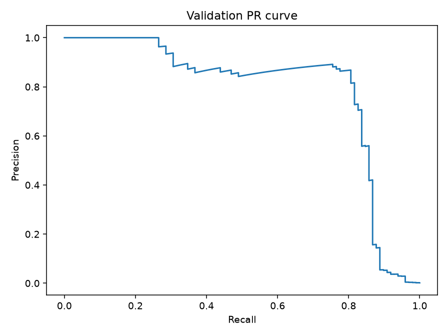
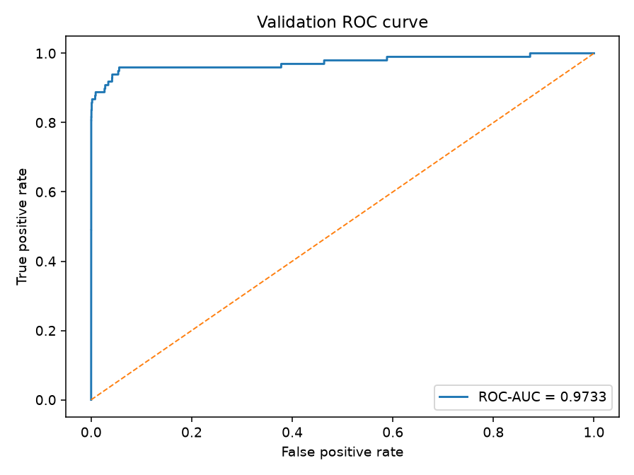

# Лабораторна робота 2

Виявлення шахрайських транзакцій у Credit Card Fraud Detection та вибір порога за вартістю помилок.

## Відтворення результатів

З кореня репозиторію:

```powershell
cd lab2
uv sync --locked --python 3.12
uv run --locked python lab2_starter.py --saved results
uv run --locked python analyze_thresholds.py --saved results
```

Ці команди використовують збережені прогнози; CSV і повторне навчання для аналізу не потрібні. Версії залежностей зафіксовані в `uv.lock`.

Для нового навчання поклади `creditcard.csv` у корінь репозиторію та вкажи нову порожню теку:

```powershell
uv run --locked python lab2_starter.py --data ..\creditcard.csv --out results_retrained
uv run --locked python analyze_thresholds.py --saved results_retrained
```

Уже заповнену теку результатів скрипт не перезаписує. Датасет: [Credit Card Fraud Detection](https://www.kaggle.com/datasets/mlg-ulb/creditcardfraud). Файл `creditcard.csv` до GitHub не додається.

Для покрокового перегляду з теки `lab2`:

```powershell
uv run --with jupyter --with ipykernel jupyter notebook lab2.ipynb
```

Notebook викликає ті самі функції, що й Python скрипти. За замовчуванням він читає `results`. Для навчання розкоментуй два рядки в секції навчання: новий запуск збережеться в `notebook_results`, а наступні клітинки виконають його повний аналіз.

## Дані та поділ

Датасет містить 284807 транзакцій, із них 492 шахрайські. Цільова мітка $y_i$ береться з `Class`. Вхід містить 29 ознак: `V1 ... V28` і `Amount`. `Time` і `Class` до входу моделі не потрапляють. Сирий `Amount` та початковий індекс кожного рядка зберігаються окремо.

Спочатку `train_test_split` виділяє 60% train і 40% тимчасової вибірки; потім тимчасова вибірка ділиться навпіл на validation і test. Обидва виклики стратифіковані за `Class` та мають `random_state=0`.

| Частина | Об'єкти | Fraud | Частка fraud |
|---|---:|---:|---:|
| train | 170884 | 295 | 0.001726 |
| validation | 56961 | 98 | 0.001720 |
| test | 56962 | 99 | 0.001738 |

`StandardScaler` навчається лише на train:

$$
\begin{aligned}
\mu_j &= \frac{1}{N_{\mathrm{train}}}\sum_{i\in\mathrm{train}}x_{ij},\\
\sigma_j &= \sqrt{\frac{1}{N_{\mathrm{train}}}
\sum_{i\in\mathrm{train}}(x_{ij}-\mu_j)^2},\\
\widetilde x_{ij} &= \frac{x_{ij}-\mu_j}{\sigma_j}.
\end{aligned}
$$

До validation і test застосовуються ті самі $\mu_j$ та $\sigma_j$. Після стандартизації ознаки переводяться у `float32`.

Обчислення статистик на всьому наборі передало б інформацію про validation і test у підготовку моделі. Це витік даних: відкладені вибірки перестали б бути незалежною перевіркою. Тому `fit` виконується лише на train.

## Модель і навчання

$$
\begin{aligned}
h_i &= \mathrm{ReLU}(W_1\widetilde x_i+b_1),
& h_i&\in\mathbb{R}^{32},\\
z_i &= w_2^{\mathsf T}h_i+b_2,
& s_i&=\mathrm{sigmoid}(z_i).
\end{aligned}
$$

Архітектура в PyTorch: `Linear(29,32) -> ReLU -> Linear(32,1)`. Навчання працює з логітами через `BCEWithLogitsLoss` із середнім за batch:

$$
L=-\frac{1}{B}\sum_{i=1}^{B}
\left[y_i\log\sigma(z_i)+(1-y_i)\log\big(1-\sigma(z_i)\big)\right].
$$

Цю функцію PyTorch обчислює чисельно стійко; окремий sigmoid застосовується лише для отримання оцінок $s_i$ після навчання.

Налаштування: CPU, `float32`, Adam з $\eta=10^{-3}$, 12 епох, batch 1024, включно з останнім неповним batch. Перед створенням моделі встановлюється `torch.manual_seed(0)`; порядок train-об'єктів на кожній епосі задає окремий `np.random.default_rng(0)`.

## Поріг і вартість помилок

Для оцінки $s_i$ використовується правило:

$$
\widehat y_i(t)=\mathbf{1}[s_i\ge t].
$$

Лічильники обчислюються вручну:

$$
\begin{aligned}
\mathrm{TP}(t)&=\sum_i y_i\widehat y_i(t),
&\mathrm{FP}(t)&=\sum_i(1-y_i)\widehat y_i(t),\\
\mathrm{FN}(t)&=\sum_i y_i\big(1-\widehat y_i(t)\big),
&\mathrm{TN}(t)&=\sum_i(1-y_i)\big(1-\widehat y_i(t)\big).
\end{aligned}
$$

Пропущена шахрайська транзакція коштує вдесятеро дорожче за хибну тривогу:

$$
C(t)=10\cdot \mathrm{FN}(t)+\mathrm{FP}(t).
$$

`Amount` не входить у цю формулу: кожна FN коштує 10, а кожна FP - 1 незалежно від суми транзакції.

Поріг вибирається лише на validation. Кандидати - всі різні оцінки та $+\infty$; за однакової вартості береться найбільший поріг:

$$
\begin{aligned}
\mathcal{T}&=\mathrm{unique}\lbrace s_i:i\in\mathrm{validation}\rbrace \cup\lbrace +\infty\rbrace ,\\
C_{\min}&=\min_{t\in\mathcal{T}}C_{\mathrm{val}}(t),\\
t^*&=\max\lbrace t\in\mathcal{T}:C_{\mathrm{val}}(t)=C_{\min}\rbrace .
\end{aligned}
$$

Оцінки сортуються за спаданням, однакові значення обробляються групою. Кумулятивні суми позитивних і негативних міток дають TP і FP, а FN і TN отримуються відніманням від загальної кількості класів. Складність пошуку - $O(n\log n)$.

Для $t=+\infty$ усі передбачення негативні, а для найменшої оцінки - усі позитивні. Повна таблиця містить 55945 кандидатів і стовпці `threshold, TP, FP, FN, TN, C`.

## Перевірка на наборах A, B, C

Для всіх кандидатів порівнюються пороги, чотири лічильники, вартість і вибраний поріг зі звичайним прямим перебором.

| Набір | Найкращий поріг | TP | FP | FN | TN | Вартість | Збіг із прямим перебором |
|---|---:|---:|---:|---:|---:|---:|:---:|
| A | 0.4 | 2 | 2 | 0 | 2 | 2 | Так |
| B | $+\infty$ | 0 | 0 | 0 | 3 | 0 | Так |
| C | 0.8 | 1 | 0 | 1 | 11 | 10 | Так |

A перевіряє спільну обробку рівних оцінок 0.7. У B немає позитивних міток. У C пороги 0.8 та 0.5 мають однакову вартість 10, тому за правилом нічиєї вибирається 0.8.

Детальні перевірки всіх кандидатів: у кожному рядку результати кумулятивних сум і незалежного прямого перебору збіглися точно. Обидва набори чисел збережені в `results/toy_sets_check.csv`.

| Набір | Поріг | TP | FP | FN | TN | C | Точний збіг |
|---|---:|---:|---:|---:|---:|---:|:---:|
| A | $+\infty$ | 0 | 0 | 2 | 4 | 20 | Так |
| A | 0.9 | 0 | 1 | 2 | 3 | 21 | Так |
| A | 0.7 | 1 | 2 | 1 | 2 | 12 | Так |
| A | 0.4 | 2 | 2 | 0 | 2 | 2 | Так |
| A | 0.2 | 2 | 3 | 0 | 1 | 3 | Так |
| A | 0.1 | 2 | 4 | 0 | 0 | 4 | Так |
| B | $+\infty$ | 0 | 0 | 0 | 3 | 0 | Так |
| B | 0.9 | 0 | 1 | 0 | 2 | 1 | Так |
| B | 0.6 | 0 | 2 | 0 | 1 | 2 | Так |
| B | 0.3 | 0 | 3 | 0 | 0 | 3 | Так |
| C | $+\infty$ | 0 | 0 | 2 | 11 | 20 | Так |
| C | 0.8 | 1 | 0 | 1 | 11 | 10 | Так |
| C | 0.5 | 2 | 10 | 0 | 1 | 10 | Так |
| C | 0.2 | 2 | 11 | 0 | 0 | 11 | Так |

## Результати validation

ROC-AUC дорівнює **0.9733178958**.

ROC-AUC оцінює ранжування за всіма порогами й не враховує задану ціну FN та FP. Велика кількість легітимних транзакцій означає, що навіть мала частка хибних тривог може дати багато FP та знизити precision. Тому висока ROC-AUC не гарантує ані високої precision, ані малої вартості на конкретному порозі.

Знайдений поріг:

$$
t^*=0.03119388222694397.
$$

| Правило | Поріг | TP | FP | FN | TN | Вартість |
|---|---:|---:|---:|---:|---:|---:|
| Стандартний | 0.5 | 71 | 9 | 27 | 56854 | 279 |
| Мінімум вартості | 0.0311938822 | 82 | 34 | 16 | 56829 | 194 |
| Усі негативні | $+\infty$ | 0 | 0 | 98 | 56863 | 980 |

Нижчий поріг зменшив кількість FN з 27 до 16 і збільшив кількість FP з 9 до 34. За заданими вартостями це зменшило загальну вартість з 279 до 194.





## Результати test

Зафіксований на validation поріг $t^*$ застосовується до test без додаткового підбору.

| TP | FP | FN | TN | Вартість |
|---:|---:|---:|---:|---:|
| 80 | 43 | 19 | 56820 | 233 |

$$
\begin{aligned}
\mathrm{Precision}&=\frac{\mathrm{TP}}{\mathrm{TP}+\mathrm{FP}}
=\frac{80}{123}\approx0.6504,\\
\mathrm{Recall}&=\frac{\mathrm{TP}}{\mathrm{TP}+\mathrm{FN}}
=\frac{80}{99}\approx0.8081.
\end{aligned}
$$

Обидва знаменники ненульові. Загалом precision не визначений за відсутності позитивних передбачень, а recall - за відсутності позитивних міток. Для нульового знаменника `safe_rate` повертає `None`, що записується як `null` у JSON.

## Приклади помилок

Вибрані перші п'ять FP і перші п'ять FN за початковим індексом рядка. Поле `csv_row` - індекс транзакції від нуля без заголовка; фізичний номер рядка у CSV дорівнює `csv_row + 2`.

| Індекс | Тип | Мітка | Оцінка $s_i$ | Сирий Amount | $\lvert s_i-t^*\rvert$ |
|---:|---|---:|---:|---:|---:|
| 460 | FP | 0 | 0.196159 | 2.00 | 0.164965 |
| 2961 | FP | 0 | 0.080961 | 2.49 | 0.049767 |
| 10783 | FP | 0 | 0.966327 | 89.99 | 0.935133 |
| 13405 | FP | 0 | 0.932032 | 89.99 | 0.900838 |
| 13617 | FP | 0 | 0.922762 | 89.99 | 0.891568 |
| 10497 | FN | 1 | 0.011464 | 3.79 | 0.019730 |
| 52521 | FN | 1 | 0.006373 | 105.99 | 0.024821 |
| 55401 | FN | 1 | 0.005642 | 1.00 | 0.025552 |
| 91671 | FN | 1 | 0.000500 | 290.18 | 0.030693 |
| 93486 | FN | 1 | 0.018352 | 0.00 | 0.012842 |

Серед цих FP суми лежать між 2.00 і 89.99, а серед FN - між 0.00 і 290.18. FP трапляються і на малих сумах; найбільша сума тут належить FN. Одного `Amount` недостатньо для пояснення цих помилок.

Найближча до порога FN має індекс 93486 і відстань приблизно 0.01284. Три FP із сумою 89.99 мають оцінки понад 0.92 і далеко лежать вище порога: ці хибні тривоги не обмежуються оцінками поблизу межі рішення.

Десять прикладів не дозволяють узагальнити причини помилок: вибірка мала та відібрана за індексом, а ознаки `V1 ... V28` анонімізовані.

## Збережені файли

У `results` містяться:

- `model.pt` - ваги моделі;
- `predictions.npz` - індекси поділу, мітки, сирий Amount та нерозкруглені оцінки validation і test;
- `preprocessing.npz` - параметри стандартизації та список ознак;
- `run.json` і `split_summary.csv` - налаштування запуску та склад вибірок;
- `validation_threshold_candidates.csv` - повна таблиця порогів;
- `validation_threshold_comparison.csv` - порівняння 0.5, $t^*$ і $+\infty$;
- `toy_sets_summary.csv` і `toy_sets_check.csv` - підсумок та детальні перевірки A, B, C;
- `validation_pr.png` і `validation_roc.png` - графіки;
- `test_errors.csv` - п'ять FP і п'ять FN;
- `threshold_report.json` - підсумкові метрики.

## Висновок

Зміна порога незмінної моделі на validation зменшила FN з 27 до 16 ціною збільшення FP з 9 до 34; за заданими вартостями це дало 194 замість 279. На test зафіксований поріг дав 19 FN, 43 FP і вартість 233. Виграш на validation не гарантує такого самого виграшу на test: поріг вибрано за конкретною скінченною validation-вибіркою, а кількість рідкісних позитивних прикладів і розподіл їхніх оцінок на test відрізняються. Test не використовувався для зміни порога чи навчання.

Джерела: умова лабораторної роботи, стартовий код, документація NumPy, pandas, scikit-learn і PyTorch, датасет Credit Card Fraud Detection. Під час підготовки коду використовувався OpenAI ChatGPT.
