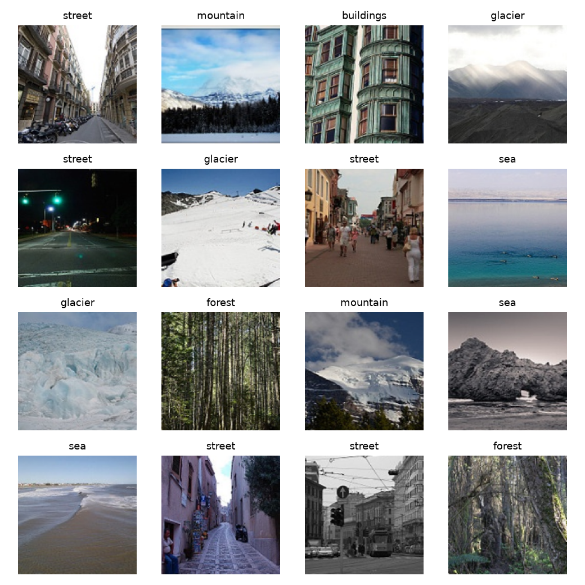
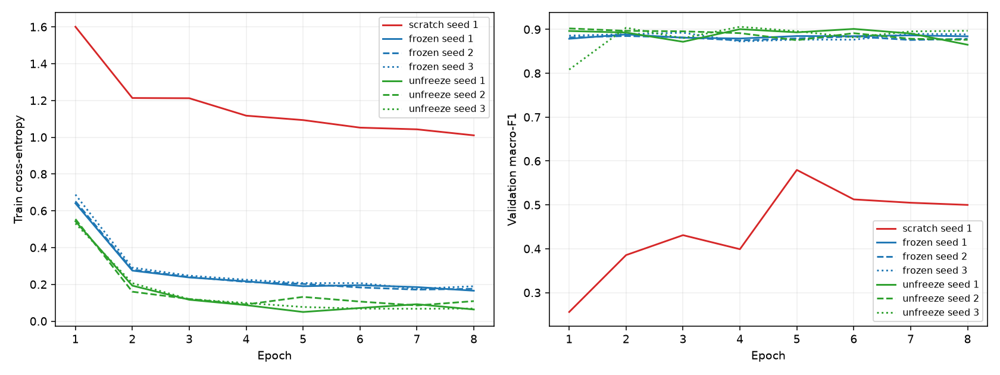
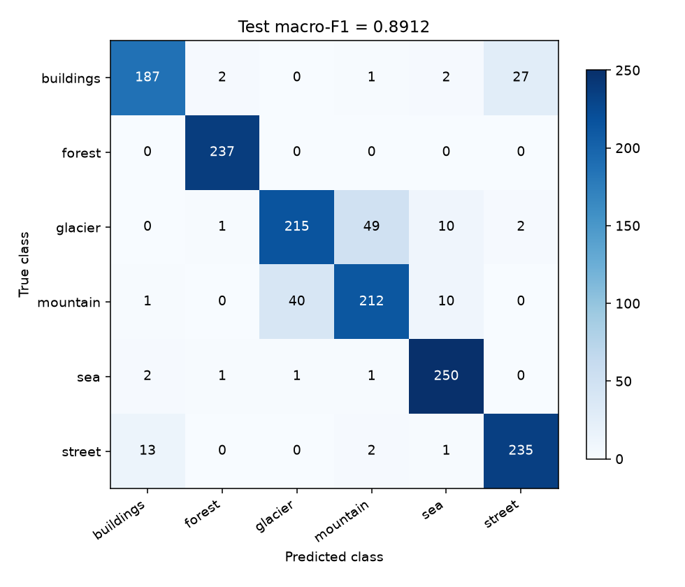
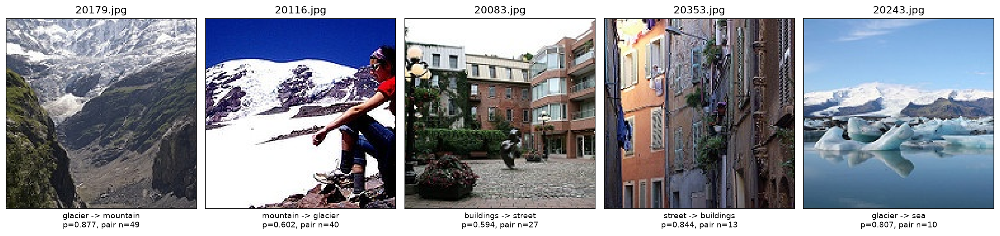

# Лабораторна робота 3

Обчислювальний експеримент із ResNet-18 на Intel Image Classification: scratch, frozen та unfreeze за однакового бюджету у 304 кроки.

## Запуск

З кореня репозиторію:

```powershell
cd lab3
uv sync --locked --python 3.12
```

Датасет: [Intel Image Classification](https://www.kaggle.com/datasets/puneet6060/intel-image-classification). Розпакуй `seg_train` і `seg_test` у локальну теку. Наприклад, для розташування `../data/intel-image-classification/seg_train/seg_train/<клас>/*.jpg` і такої самої вкладеності `seg_test` дві команди мають вигляд:

```powershell
uv run --locked python train.py --data ../data/intel-image-classification --out reproduced
uv run --locked python analyze.py --data ../data/intel-image-classification --out reproduced
```

`--data` можна замінити на абсолютний шлях до свого набору. Навчання використовує CUDA, MPS або CPU, залежно від доступності. Наявні результати не перезаписуються; `reproduced` має бути новою текою. Для відтворення **збережених у цьому репозиторії** чисел достатньо команди аналізу:

```powershell
uv run --locked python analyze.py --data ../data/intel-image-classification --out .
```

Виконане навчання запускалося з `--out . --device cuda`. Аналіз завжди обчислює test на CPU. Повторення аналізу дозволене, але не є підставою змінювати модель.

Notebook використовує ті самі функції, що й скрипти:

```powershell
uv run --with jupyter --with ipykernel jupyter notebook lab3.ipynb
```

За замовчуванням notebook показує збережені результати без повторного навчання й тестування. Для нового експерименту встанови `RUN_TRAINING = True`, а потім `RUN_ANALYSIS = True` у відповідних клітинках.

## 1. Дані й перевірки до навчання

Використано 14034 зображення з `seg_train` і 3000 з `seg_test`; `seg_pred` не використовується. Зображення відкриваються через Pillow з `convert('RGB')`; менші за висотою файли не відкидаються. Індекси класів 0–5: buildings, forest, glacier, mountain, sea, street.

Імена сортуються як рядки. Один `np.random.default_rng(0)` послідовно перемішує індекси всіх класів `seg_train`, звідки беруться перші 200 файлів кожного класу. Новий генератор з тим самим зерном ділить кожен клас `seg_test`: перша половина — validation, решта — test. Усі завантажувачі далі читають лише `split.csv`.

Контроль поділу: у клітинках **кількість / сума числових імен**. Усі 18 клітинок точно збіглися з умовою, всі 4200 імен унікальні, перетинів між частинами немає.

| Клас | train | validation | test |
|---|---:|---:|---:|
| buildings | 200 / 1996761 | 218 / 4837323 | 219 / 4837559 |
| forest | 200 / 2032625 | 237 / 5276962 | 237 / 5291326 |
| glacier | 200 / 2183923 | 276 / 6135652 | 277 / 6157250 |
| mountain | 200 / 1950345 | 262 / 5789535 | 263 / 5849765 |
| sea | 200 / 1987613 | 255 / 5655068 | 255 / 5668011 |
| street | 200 / 1841817 | 250 / 5541845 | 251 / 5547533 |
| Разом | 1200 / 11993084 | 1498 / 33236385 | 1502 / 33351444 |

Train-перетворення: `RandomResizedCrop(160, scale=(0.7, 1.0))`, `RandomHorizontalFlip()`, `ToTensor()`, `Normalize(mean, std)`. Для validation і test — `Resize((160,160))`, `ToTensor()`, те саме нормування. Інші аргументи — за замовчуванням torchvision: білінійна інтерполяція, `antialias=True`, для crop `ratio=(0.75,4/3)`, для flip `p=0.5`.

$$
\mu=(0.485,0.456,0.406),\qquad
\sigma=(0.229,0.224,0.225),\qquad
\widetilde x_c=\frac{x_c-\mu_c}{\sigma_c}.
$$

Перші 16 зображень навчального batch після аугментацій; нормування обернено лише для показу:



### Початкова втрата

Нові моделі зі зерном 1, після `set_train_mode`, перший train-batch, `torch.no_grad()`, без кроків оптимізатора:

| Модель | Початкова cross-entropy |
|---|---:|
| scratch | 2.047949 |
| frozen | 1.924237 |
| Рівномірні ймовірності: $\ln 6$ | 1.791759 |

Випадково ініціалізована голова не дає рівно однакових імовірностей; у scratch випадковий також кістяк. ImageNet-ознаки у frozen ще не узгоджені з новою випадковою головою. Тому втрата одного batch відрізняється від $\ln 6$; це орієнтир для рівномірного прогнозу, а не обов'язковий результат ініціалізації. Обидва екземпляри після перевірки відкинуто: навіть під `no_grad()` тренувальний BN може оновити буфери.

## 2. Режими навчання

Для кожної нової моделі спочатку встановлюються `torch.manual_seed(seed)` та `np.random.seed(seed)`, потім створюється `resnet18`, замінюється `fc` на `Linear(512,6)` зі стандартною ініціалізацією, налаштовується `requires_grad`, модель переноситься на пристрій і створюється AdamW.

| Режим | Ваги | Усього параметрів | Навчаються | Групи оптимізатора: кількість, lr |
|---|---|---:|---:|---|
| scratch | випадкові | 11179590 | 11179590 | all: 11179590, 0.003 |
| frozen | IMAGENET1K_V1 | 11179590 | 3078 | fc: 3078, 0.003 |
| unfreeze | IMAGENET1K_V1 | 11179590 | 8396806 | fc: 3078, 0.003; layer4: 8393728, 0.0003 |

Усі перевірки кількості, груп і відсутності заморожених параметрів в оптимізаторі пройдені. Менший lr для `layer4` обмежує зміну вже корисних ознак, тоді як нову голову потрібно навчити з нуля. В усіх групах `weight_decay=0.0001`, інші аргументи AdamW стандартні, зокрема `betas=(0.9,0.999)`, `eps=1e-8`, `amsgrad=False`. BN має `momentum=0.1`, `eps=1e-5`.

Окремі нові моделі frozen та unfreeze зробили по 5 кроків на перших 5 train-batch. Порівнювалися копії повного `state_dict()` через точний `torch.equal`, включно з `running_mean`, `running_var` і `num_batches_tracked`.

| Режим | Модуль | Параметри змінилися | Статистики BN змінилися | Збіг з очікуванням |
|---|---|:---:|:---:|:---:|
| frozen | conv1 | ні | немає BN | так |
| frozen | bn1 | ні | ні | так |
| frozen | layer1 | ні | ні | так |
| frozen | layer2 | ні | ні | так |
| frozen | layer3 | ні | ні | так |
| frozen | layer4 | ні | ні | так |
| frozen | fc | так | немає BN | так |
| unfreeze | conv1 | ні | немає BN | так |
| unfreeze | bn1 | ні | ні | так |
| unfreeze | layer1 | ні | ні | так |
| unfreeze | layer2 | ні | ні | так |
| unfreeze | layer3 | ні | ні | так |
| unfreeze | layer4 | так | так | так |
| unfreeze | fc | так | немає BN | так |

### Дослід із навмисною помилкою BN

Прогноз, записаний до запуску: у frozen зі звичайним `model.train()` параметри замороженого кістяка не зміняться, але його `running_mean`, `running_var` і `num_batches_tracked` зміняться; параметри `fc` зміняться. Спад train-loss сам по собі не виявить помилку. Прогноз також збережено у `results/preflight.json`.

Результат на новій моделі зі зерном 1 після 5 кроків без `set_train_mode`:

| Модуль | Параметри змінилися | Статистики BN змінилися | Збіг із прогнозом |
|---|:---:|:---:|:---:|
| conv1 | ні | немає BN | так |
| bn1 | ні | так | так |
| layer1 | ні | так | так |
| layer2 | ні | так | так |
| layer3 | ні | так | так |
| layer4 | ні | так | так |
| fc | так | немає BN | так |

Максимальні абсолютні зміни в `layer1.0.bn1`:

| Варіант frozen | running_mean | running_var |
|---|---:|---:|
| Правильний `set_train_mode` | 0 | 0 |
| Помилковий `model.train()` | 0.09282255 | 0.12034309 |

У помилковому варіанті loss за п'ять кроків: 1.886914, 1.945674, 1.844253, 1.683736, 1.407363 — загалом знижується, попри неправильний режим. `requires_grad=False` вимикає градієнти параметрів, а статистики BN — це буфери, які оновлюються під час прямого проходу в `train()`. Тому заморожені модулі потрібно явно перевести в `eval()`. Для `layer4` у unfreeze оновлення параметрів і статистик правильне: цей блок адаптується до нової задачі. Перед **кожною** епохою `set_train_mode` повторює `model.train()` і `eval()` заморожених модулів.

Усі перевірки завершилися до основного експерименту. Перевірочні моделі не оцінювалися на validation, не зберігалися й не входять до семи запусків.

## 3. Протокол основного експерименту

Кожен запуск: 8 епох, batch 32, `shuffle=True`, `drop_last=False`, `num_workers=0`, без власних generator і sampler. Останній batch містить 16 зображень; 38 кроків за епоху, разом 304. Validation і test мають batch 64, `shuffle=False` та порядок рядків `split.csv`. Усі обчислення моделі — `float32`.

На train: `zero_grad()`, прямий прохід, стандартна `CrossEntropyLoss()`, `backward()`, `step()`. Втрата batch береться до оновлення його ваг; втрата епохи зважується розмірами batch:

$$
L_{\mathrm{epoch}}=\frac{1}{1200}\sum_b |b|L_b.
$$

Після кожної епохи — `eval()`, `no_grad()` і validation:

$$
F_{1,k}=\frac{2\mathrm{TP}_k}{2\mathrm{TP}_k+\mathrm{FP}_k+\mathrm{FN}_k},\qquad
F_{r,s}=\frac{1}{6}\sum_{k=0}^{5}F_{1,k}.
$$

Підсумок — **лише епоха 8**, навіть якщо раніше validation був вищим. Scheduler, gradient clipping, AMP, label smoothing, ваги класів, early stopping і вибір епохи не застосовуються. Під час навчання жодна модель не обчислює test.

### Сім запусків

| № | Режим | Зерно | Train-loss, епоха 8 | Macro-F1 validation, епоха 8 | Час, с |
|---:|---|---:|---:|---:|---:|
| 1 | scratch | 1 | 1.010167 | 0.499898 | 86.74 |
| 2 | frozen | 1 | 0.165472 | 0.884201 | 77.77 |
| 3 | frozen | 2 | 0.175659 | 0.878500 | 77.58 |
| 4 | frozen | 3 | 0.189572 | 0.888596 | 77.20 |
| 5 | unfreeze | 1 | 0.063509 | 0.865052 | 76.97 |
| 6 | unfreeze | 2 | 0.108795 | 0.876207 | 73.73 |
| 7 | unfreeze | 3 | 0.068530 | 0.896838 | 74.61 |



Версії: Python 3.12.0, PyTorch 2.11.0+cu128, torchvision 0.26.0+cu128, NumPy 2.5.4. Навчання: NVIDIA GeForce RTX 3050 Laptop GPU, CUDA, 6 CPU-потоків PyTorch. Повні версії залежностей зафіксовані в `uv.lock`, CUDA-пакети для Windows беруться з офіційного індексу PyTorch. Відхилень від налаштувань завдання немає. Час виміряно із синхронізацією CUDA, він охоплює 8 train-епох разом із validation, але не побудову моделі й попередні перевірки.

Усі сім журналів посилаються на коміт навчального коду `1b64a1d8bcd9f2beba9e76f2259f3dfee43ba09a`. `dirty=true` чесно фіксує незакомічені файли звітів та інші робочі файли репозиторію. `train.py` і `experiment.py` під час семи навчань не змінювалися. Після отримання результатів доповнено звіт і notebook та виправлено лише поля рисунка помилок в `analyze.py`; модель і правило вибору не змінювалися.

SHA-256 `split.csv` у всіх семи журналах і поточному файлі:

```text
2355c7d27aa1ee5ebd86f5d4a5fa396181a647cd0c5336a4f380ce965a3fd039
```

Для цього CSV у `.gitattributes` зафіксовано LF, щоб Git у Windows не змінив контрольний хеш. Поруч із кожним журналом збережено `val_logits.npy`: `float32`, форма `(1498,6)`, порядок validation-рядків CSV. Аналіз перевіряє однакові хеші поділу, наявність рівно семи запусків і відповідність фінальних логітів записаним macro-F1; інший поділ зупиняє аналіз до завантаження test.

## 4. Розклад ефектів

Для frozen та unfreeze:

$$
\begin{aligned}
\overline F_r&=\frac{1}{3}\sum_{s=1}^{3}F_{r,s},\\
R_r&=\max_s F_{r,s}-\min_s F_{r,s},\\
R&=\max(R_{\mathrm{frozen}},R_{\mathrm{unfreeze}}),\\
\Delta_{\mathrm{pre}}&=\overline F_{\mathrm{frozen}}-F_{\mathrm{scratch},1},\\
\Delta_{\mathrm{unf}}&=\overline F_{\mathrm{unfreeze}}-\overline F_{\mathrm{frozen}},\\
\Delta_{\mathrm{pre}}+\Delta_{\mathrm{unf}}&=\overline F_{\mathrm{unfreeze}}-F_{\mathrm{scratch},1}.
\end{aligned}
$$

| Величина | Значення |
|---|---:|
| $\overline F_{\mathrm{frozen}}$ | 0.8837657142 |
| $R_{\mathrm{frozen}}$ | 0.0100952402 |
| $\overline F_{\mathrm{unfreeze}}$ | 0.8793653627 |
| $R_{\mathrm{unfreeze}}$ | 0.0317862770 |
| $R$ | 0.0317862770 |
| $\Delta_{\mathrm{pre}}$ | +0.3838678470 |
| $\Delta_{\mathrm{unf}}$ | −0.0044003514 |
| Повний виграш трансферу | +0.3794674955 |

Тут $|\Delta_{\mathrm{pre}}|>R$: ефект попередніх ознак вартий подальшої перевірки, але це не статистичний доказ. Для розморожування $|\Delta_{\mathrm{unf}}|\le R$: різниця **не відрізняється від розкиду, результату немає**. Від'ємне середнє саме по собі не доводить шкоди від unfreeze. Розмах трьох значень — грубий і нестійкий індикатор шуму, а не довірчий інтервал чи стандартна похибка.

Що змінює зерно: у scratch — випадкову ініціалізацію кістяка й голови, перемішування batch та аугментації; у frozen — випадкову голову, перемішування й аугментації за сталих ImageNet-ознак; у unfreeze — те саме, але випадкова траєкторія впливає ще й на адаптацію `layer4` та його BN. У цих запусках unfreeze має більший розмах (0.031786 проти 0.010095), але це спостереження трьох зерен, а не загальний закон.

$R$ виміряно на запусках 2–7, тому він не оцінює розкид scratch: для нього є лише зерно 1, інша ініціалізація й усі параметри навчаються. Крива scratch не схожа на випадкове вгадування: loss зменшився з 1.600526 до 1.010167, а validation macro-F1 зріс з 0.255826 до 0.499898, хоча коливався і на епосі 5 досягав 0.579627. Навіть цей проміжний результат нижчий за всі фінальні frozen. Великий виміряний розрив узгоджується з виграшем ImageNet-ознак за цього бюджету, але одного scratch-зерна недостатньо для висновку про його варіативність. Епоху 5 замість 8 не вибираємо.

Бюджет однаковий за кроками, **не за часом**: scratch — 86.74 с, frozen — 77.20–77.77 с, unfreeze — 73.73–76.97 с. На цій невеликій задачі час також залежить від завантаження зображень, validation і стану пристрою, тому більшу кількість trainable-параметрів не можна прямо переводити у пропорційне збільшення загального часу.

## 5. Вибір і test

Найбільше середнє validation має frozen: 0.8837657142 проти 0.8793653627 для unfreeze та 0.4998978672 для scratch. Усередині frozen найкраще зерно 3: 0.8885955696. Тому команда навчання ще **до test** зберегла саме його ваги восьмої епохи в `lab3_model.pt`.

Вибір між frozen та unfreeze визначив шум, оскільки $|\Delta_{\mathrm{unf}}|\le R$. Окремий unfreeze seed 3 має 0.8968378142, але вибирати за ним режим не можна: спочатку порівнюються середні режимів, а не максимуми всіх семи запусків.

Checkpoint має лише потрібні ключі: `state_dict`, `regime='frozen'`, `seed=3`, `classes` у фіксованому порядку, `img_size=160`; розмір приблизно 44.8 МБ. Ваги решти запусків зберігалися локально до вибору, але не додаються до Git. Аналіз повторює вибір із журналів і перевіряє також хеш самих ваг, перш ніж обчислювати test на CPU.

| Величина | Значення |
|---|---:|
| Validation macro-F1 вибраного запуску | 0.8885955696 |
| Test macro-F1 | 0.8912105507 |
| Test accuracy | 0.8894806924 |
| Кількість test-зображень | 1502 |
| Правильні / помилкові відповіді | 1336 / 166 |
| Стандартна похибка accuracy | 0.0080900718 |

Матриця плутанини: рядки — справжній клас, стовпці — передбачений.

| Справжній / передбачений | buildings | forest | glacier | mountain | sea | street |
|---|---:|---:|---:|---:|---:|---:|
| buildings | 187 | 2 | 0 | 1 | 2 | 27 |
| forest | 0 | 237 | 0 | 0 | 0 | 0 |
| glacier | 0 | 1 | 215 | 49 | 10 | 2 |
| mountain | 1 | 0 | 40 | 212 | 10 | 0 |
| sea | 2 | 1 | 1 | 1 | 250 | 0 |
| street | 13 | 0 | 0 | 2 | 1 | 235 |



Вибір найкращого з трьох зерен робить його validation-оцінку оптимістичною в середньому. Тут такого знака зміщення не видно: test **вищий** на 0.0026149810, або 0.2615 пункту macro-F1. Це не спростовує зміщення від вибору: на конкретних незалежних скінченних вибірках випадковий склад зображень може приховати його або змінити знак різниці.

Порядок шуму для частки правильних відповідей:

$$
\mathrm{SE}_{\mathrm{accuracy}}=\sqrt{\frac{p(1-p)}{n}}
=\sqrt{\frac{0.8894806924(1-0.8894806924)}{1502}}
\approx0.0080901.
$$

Це приблизно 0.81 відсоткового пункту accuracy — більше за спостережувану різницю macro-F1 у 0.26 пункту за порядком величини. Але це **не** стандартна похибка macro-F1 і не формальний тест різниці validation/test: macro-F1 залежить від шести матриць one-vs-rest, а обидві вибірки мають власний шум.

### П'ять характерних помилок

Вибрано п'ять найчастіших ненульових позадіагональних пар; за однакової частоти — за індексом справжнього, потім передбаченого класу. Для кожної пари береться перший за рядковим сортуванням файл test. На п'ятому місці glacier → sea випереджає mountain → sea за індексом класу; обидві пари мають по 10 помилок. Якби різних пар було менше п'яти, алгоритм добирав би наступні за іменем файли пар у тому самому порядку.

| Файл | Справжній клас | Передбачений клас | Softmax передбаченого класу | Частота пари в test |
|---|---|---|---:|---:|
| 20179.jpg | glacier | mountain | 0.877206 | 49 |
| 20116.jpg | mountain | glacier | 0.601541 | 40 |
| 20083.jpg | buildings | street | 0.593569 | 27 |
| 20353.jpg | street | buildings | 0.844027 | 13 |
| 20243.jpg | glacier | sea | 0.806998 | 10 |



- `20179.jpg` — сцена містить обидва класи: скелясті гірські схили оточують засніжену льодовикову долину.
- `20116.jpg` — сцена містить обидва класи: гірський рельєф поєднано з великим суцільним снігово-льодовим полем.
- `20083.jpg` — сцена містить обидва класи: будівлі обрамляють вимощений міський простір, схожий на вулицю.
- `20353.jpg` — ймовірна помилка розмітки: кадр майже повністю заповнений фасадами будівель, а сама вулиця майже не видима.
- `20243.jpg` — помилка моделі на однозначному зображенні: великі крижини та льодовикове тло вказують на glacier, попри значну площу води.

Це візуальні інтерпретації, а не перевірені виправлення міток. Плутанина **glacier ↔ mountain** — властивість цього набору з візуально перекривними класами; мітки не «виправлялися». Впевненість softmax не гарантує правильності, що видно і з помилки `20243.jpg` з імовірністю 0.807.

## 6. Висновок

Попередньо навчені ознаки дали **додатний** ефект за бюджету 304 кроки: $\Delta_{\mathrm{pre}}=+0.3838678470$, тобто **+38.3868 пункту macro-F1** (frozen 0.8837657142 проти scratch 0.4998978672). Це більше за $R=0.0317862770$, або 3.1786 пункту: ефект вартий перевірки, але одним scratch-зерном його статистично не доведено.

Розморожування дало **від'ємну виміряну різницю**: $\Delta_{\mathrm{unf}}=-0.0044003514$, тобто **−0.4400 пункту macro-F1** (unfreeze 0.8793653627 проти frozen 0.8837657142). Її модуль менший за 3.1786 пункту розкиду, тому ефект не відрізняється від шуму: **результату щодо користі чи шкоди донавчання немає**. Повний виграш unfreeze проти scratch становить +37.9467 пункту за тих самих 304 кроків; із довшим навчанням scratch міг би скоротити відставання.

Для нової задачі з 200 зображеннями на клас я почав би з **frozen**: тут він має менший розкид і не гіршу середню якість, а час практично зіставний із unfreeze; перевага розморожування за цього бюджету не встановлена. Підсумкова обрана модель frozen seed 3 дала test macro-F1 0.8912105507; після цього модель, гіперпараметри й кількість епох не змінювалися.

## Файли

- `experiment.py` — поділ, дані, перетворення, модель і режими.
- `train.py` — перевірки, сім навчань, журнали й вибір моделі без test.
- `analyze.py` — перевірка журналів і ваг, ефекти та test на CPU.
- `lab3.ipynb` — покроковий перегляд і запуск тих самих функцій.
- `pyproject.toml`, `uv.lock` — залежності; `split.csv` — фіксований поділ.
- `runs/` — сім `run.json` і сім `val_logits.npy`.
- `lab3_model.pt` — вибраний checkpoint для цієї роботи й ЛР4.
- `results/` — чотири потрібні рисунки, таблиці перевірок і метрик та їхні JSON-результати.

Дані й проміжні ваги до репозиторію не додаються. Повторне навчання має відтворювати поділ, налаштування й відповіді перевірок режимів; значення F1 на GPU можуть відрізнятися через недетермінованість і платформу. Аналіз збережених журналів та checkpoint має відтворювати числа цього звіту; усі наведені test-числа взяті з його виводу, округлення — лише для показу.

Джерела: умова ЛР3, [датасет Intel Image Classification](https://www.kaggle.com/datasets/puneet6060/intel-image-classification), [ResNet-18 у torchvision](https://docs.pytorch.org/vision/stable/models/generated/torchvision.models.resnet18.html), [BatchNorm2d](https://docs.pytorch.org/docs/stable/generated/torch.nn.BatchNorm2d.html), [AdamW](https://docs.pytorch.org/docs/stable/generated/torch.optim.AdamW.html). Під час підготовки коду й перевірок використовувався OpenAI ChatGPT; результати отримано виконанням наведених команд.
